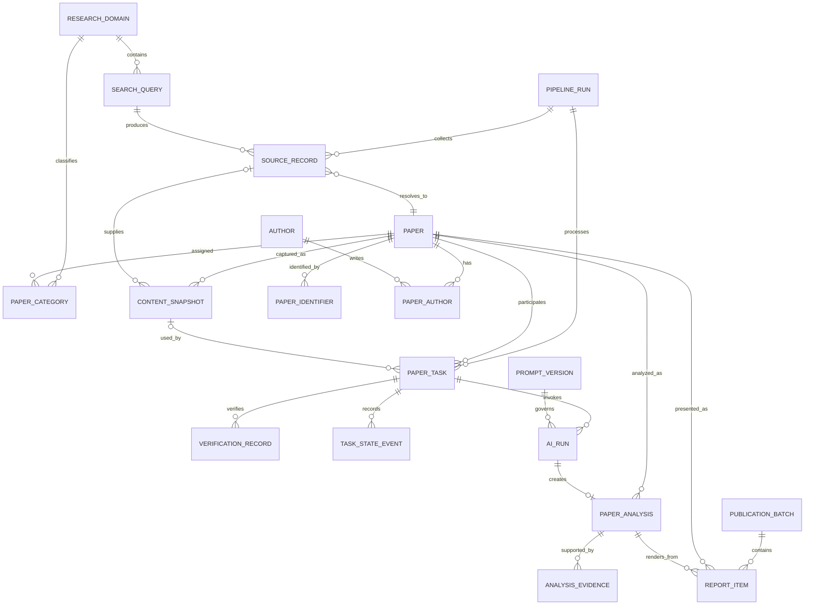

# 数据库 ER 设计

版本：`1.1.0-draft`

## 1. 设计范围

数据库承担四类数据：

1. 配置：研究领域、检索词和数据源。
2. 科研主数据：论文、作者、标识符和分类。
3. 流程数据：检索批次、原始记录、AI 输入内容快照、单篇任务、验证和 AI 执行记录。
4. 发布数据：结构化分析、证据、日报批次和报告条目。

MVP 不保存受版权限制的全文。只保存公开摘要、必要元数据、来源 URL、内容哈希及合规取得的文本片段。`content_snapshots` 只是 AI 实际输入的轻量审计快照，不是付费论文全文存储系统。

## 2. ER 总览

## 3. MVP 表清单

下列 19 张表进入 MVP。除非特别说明，时间字段均保存 UTC，展示层再转换时区。

### 3.1 `research_domains`

定义肠道健康、免疫调节、抗衰老等关注方向。

| 字段 | 类型 | 约束/说明 |
|---|---|---|
| `id` | INTEGER | PK，自增 |
| `code` | VARCHAR(64) | UNIQUE，稳定机器标识，如 `gut_health` |
| `name_zh` | VARCHAR(128) | NOT NULL |
| `description` | TEXT | 可空 |
| `is_active` | BOOLEAN | NOT NULL，默认 true |
| `created_at` | DATETIME | NOT NULL |
| `updated_at` | DATETIME | NOT NULL |

### 3.2 `search_queries`

保存可版本化的检索式；不把检索词硬编码在 Agent 中。

| 字段 | 类型 | 约束/说明 |
|---|---|---|
| `id` | INTEGER | PK |
| `domain_id` | INTEGER | FK → `research_domains.id`，RESTRICT |
| `source` | VARCHAR(32) | NOT NULL，首版固定 `pubmed` |
| `query_text` | TEXT | NOT NULL，完整布尔检索式 |
| `lookback_days` | INTEGER | NOT NULL，默认 7，CHECK > 0 |
| `version` | INTEGER | NOT NULL，默认 1 |
| `is_active` | BOOLEAN | NOT NULL |
| `created_at` | DATETIME | NOT NULL |

唯一约束：`(domain_id, source, version)`。

### 3.3 `pipeline_runs`

一次调度对应一条记录，是批次级审计入口。

| 字段 | 类型 | 约束/说明 |
|---|---|---|
| `id` | VARCHAR(36) | PK，UUID 字符串，便于 SQLite/PostgreSQL 迁移 |
| `trigger_type` | VARCHAR(16) | `scheduled` / `manual` / `replay` |
| `status` | VARCHAR(24) | 批次状态枚举，见状态流转文档 |
| `config_snapshot` | JSON/TEXT | NOT NULL，当次领域、时间窗、模型等配置快照 |
| `started_at` | DATETIME | 可空 |
| `finished_at` | DATETIME | 可空 |
| `total_candidates` | INTEGER | NOT NULL，默认 0 |
| `published_count` | INTEGER | NOT NULL，默认 0 |
| `failed_count` | INTEGER | NOT NULL，默认 0 |
| `error_summary` | TEXT | 可空，仅存批次级摘要 |
| `created_at` | DATETIME | NOT NULL |

索引：`(status, created_at)`。

### 3.4 `source_records`

保存外部 API 返回的必要原始快照，用于重放解析和排查数据差异。

| 字段 | 类型 | 约束/说明 |
|---|---|---|
| `id` | INTEGER | PK |
| `pipeline_run_id` | VARCHAR(36) | FK → `pipeline_runs.id`，CASCADE |
| `search_query_id` | INTEGER | FK → `search_queries.id`，RESTRICT |
| `source` | VARCHAR(32) | NOT NULL |
| `external_id` | VARCHAR(255) | NOT NULL，如 PMID |
| `raw_payload` | JSON/TEXT | NOT NULL，裁剪后的 API 数据 |
| `payload_sha256` | CHAR(64) | NOT NULL |
| `paper_id` | INTEGER | FK → `papers.id`，SET NULL；标准化前可空 |
| `fetched_at` | DATETIME | NOT NULL |

唯一约束：`(pipeline_run_id, source, external_id)`。索引：`paper_id`。

### 3.5 `content_snapshots`

记录 AI 某次分析实际使用的合规文本快照。每条记录可包含摘要或少量允许保存的文本片段，不用于归档受版权限制的完整论文。

| 字段 | 类型 | 约束/说明 |
|---|---|---|
| `id` | VARCHAR(36) | PK，UUID；对应 Workflow 的 `content_snapshot_id` |
| `paper_id` | INTEGER | FK → `papers.id`，CASCADE |
| `source_record_id` | INTEGER | 可空，FK → `source_records.id`，SET NULL |
| `source_type` | VARCHAR(32) | `pubmed_abstract` / `pmc_open_access` / `publisher_excerpt` / `manual_excerpt` |
| `content_scope` | VARCHAR(24) | `abstract` / `open_access_text` / `excerpt` |
| `sections_json` | JSON/TEXT | NOT NULL；数组元素含 `section_id`、`name`、`text`，只保存实际送入 AI 的内容 |
| `content_sha256` | CHAR(64) | NOT NULL；对规范化后完整输入内容计算 |
| `source_url` | TEXT | NOT NULL |
| `rights_basis` | VARCHAR(32) | `public_metadata` / `open_access` / `licensed_excerpt` / `user_provided` |
| `is_truncated` | BOOLEAN | NOT NULL，默认 false |
| `truncation_reason` | VARCHAR(255) | 可空 |
| `retrieved_at` | DATETIME | NOT NULL |
| `created_at` | DATETIME | NOT NULL |

唯一约束：`(paper_id, content_sha256)`；索引：`source_record_id`、`retrieved_at`。

合规守卫：`publisher_excerpt` 和 `manual_excerpt` 只能保存完成当前分析所需的有限片段；未知授权状态不得标记为 `open_access`。抓取器不得绕过付费墙、登录或访问控制。

### 3.6 `papers`

去重后的论文主表，只放稳定、可复用的科研元数据。

| 字段 | 类型 | 约束/说明 |
|---|---|---|
| `id` | INTEGER | PK |
| `canonical_title` | TEXT | NOT NULL，保留原文标题 |
| `normalized_title` | TEXT | NOT NULL，供兜底去重 |
| `abstract` | TEXT | 可空 |
| `journal_name` | VARCHAR(255) | 可空 |
| `publication_date` | DATE | 可空，不确定到日时使用月首/年首并记录精度 |
| `publication_date_precision` | VARCHAR(8) | `day` / `month` / `year` / `unknown` |
| `language` | VARCHAR(16) | 可空，ISO 639-1 优先 |
| `article_type` | VARCHAR(64) | 可空，如 `clinical_trial` |
| `pubmed_url` | TEXT | 可空 |
| `publisher_url` | TEXT | 可空 |
| `metadata_status` | VARCHAR(24) | `unverified` / `verified` / `conflict` |
| `first_seen_at` | DATETIME | NOT NULL |
| `last_seen_at` | DATETIME | NOT NULL |
| `created_at` | DATETIME | NOT NULL |
| `updated_at` | DATETIME | NOT NULL |

索引：`normalized_title`、`publication_date`、`metadata_status`。

### 3.7 `paper_identifiers`

避免在 `papers` 上继续增加 PMID、DOI、PMC 等字段。

| 字段 | 类型 | 约束/说明 |
|---|---|---|
| `id` | INTEGER | PK |
| `paper_id` | INTEGER | FK → `papers.id`，CASCADE |
| `scheme` | VARCHAR(16) | `pmid` / `doi` / `pmcid` / `other` |
| `value` | VARCHAR(255) | NOT NULL；DOI 小写、去除 URL 前缀 |
| `is_primary` | BOOLEAN | NOT NULL，默认 false |
| `created_at` | DATETIME | NOT NULL |

唯一约束：`(scheme, value)`；索引：`paper_id`。

去重优先级：PMID 精确匹配 → DOI 精确匹配 → 标准化标题 + 年份兜底匹配。兜底匹配不得自动合并冲突记录，应进入人工复核。

### 3.8 `authors`

| 字段 | 类型 | 约束/说明 |
|---|---|---|
| `id` | INTEGER | PK |
| `display_name` | VARCHAR(255) | NOT NULL |
| `normalized_name` | VARCHAR(255) | NOT NULL |
| `orcid` | VARCHAR(32) | 可空，存在时 UNIQUE |
| `created_at` | DATETIME | NOT NULL |

### 3.9 `paper_authors`

| 字段 | 类型 | 约束/说明 |
|---|---|---|
| `paper_id` | INTEGER | 联合 PK，FK → `papers.id`，CASCADE |
| `author_id` | INTEGER | 联合 PK，FK → `authors.id`，RESTRICT |
| `author_order` | INTEGER | NOT NULL，CHECK > 0 |
| `is_corresponding` | BOOLEAN | 可空，未知不等于 false |
| `affiliation` | TEXT | 可空，该论文中的机构快照 |

唯一约束：`(paper_id, author_order)`。

### 3.10 `paper_tasks`

同一论文在同一批次只有一个处理任务，是状态机的持久化载体。

| 字段 | 类型 | 约束/说明 |
|---|---|---|
| `id` | VARCHAR(36) | PK，UUID |
| `pipeline_run_id` | VARCHAR(36) | FK → `pipeline_runs.id`，CASCADE |
| `paper_id` | INTEGER | FK → `papers.id`，RESTRICT |
| `content_snapshot_id` | VARCHAR(36) | 可空，FK → `content_snapshots.id`，SET NULL；冻结该任务实际分析输入 |
| `state` | VARCHAR(32) | NOT NULL，单篇状态枚举 |
| `resume_state` | VARCHAR(32) | 可空；仅在 `RETRY_WAIT` 时保存恢复目标状态 |
| `relevance_score` | DECIMAL(5,4) | 可空，范围 0–1 |
| `attempt_count` | INTEGER | NOT NULL，默认 0 |
| `next_retry_at` | DATETIME | 可空 |
| `locked_by` | VARCHAR(128) | 可空，工作进程标识 |
| `locked_until` | DATETIME | 可空，租约而非永久锁 |
| `last_error_code` | VARCHAR(64) | 可空，机器可处理错误码 |
| `last_error_message` | TEXT | 可空，脱敏并截断 |
| `state_changed_at` | DATETIME | NOT NULL |
| `created_at` | DATETIME | NOT NULL |
| `updated_at` | DATETIME | NOT NULL |

唯一约束：`(pipeline_run_id, paper_id)`。索引：`(state, next_retry_at)`、`(pipeline_run_id, state)`。

### 3.11 `verification_records`

每次校验追加记录，不覆盖历史结果。

| 字段 | 类型 | 约束/说明 |
|---|---|---|
| `id` | INTEGER | PK |
| `paper_task_id` | VARCHAR(36) | FK → `paper_tasks.id`，CASCADE |
| `check_type` | VARCHAR(32) | `pmid` / `doi` / `url` / `metadata_match` |
| `target` | TEXT | NOT NULL，待验证值 |
| `status` | VARCHAR(16) | `valid` / `invalid` / `conflict` / `temporary_error` |
| `http_status` | INTEGER | 可空 |
| `resolved_url` | TEXT | 可空 |
| `response_fingerprint` | CHAR(64) | 可空 |
| `details` | JSON/TEXT | NOT NULL，默认 `{}` |
| `checked_at` | DATETIME | NOT NULL |

索引：`(paper_task_id, check_type, checked_at)`。

### 3.12 `task_state_events`

只追加的状态审计表，记录每次转换和拒绝转换；`paper_tasks` 只保存当前状态。

| 字段 | 类型 | 约束/说明 |
|---|---|---|
| `id` | INTEGER | PK |
| `paper_task_id` | VARCHAR(36) | FK → `paper_tasks.id`，CASCADE |
| `from_state` | VARCHAR(32) | 可空，创建任务时为空 |
| `to_state` | VARCHAR(32) | NOT NULL |
| `event_type` | VARCHAR(32) | `transition` / `retry` / `manual_action` / `rejected_transition` |
| `actor` | VARCHAR(128) | NOT NULL，Agent、worker 或人工操作者标识 |
| `reason_code` | VARCHAR(64) | 可空 |
| `details` | JSON/TEXT | NOT NULL，默认 `{}`；不得含密钥或大段输入 |
| `created_at` | DATETIME | NOT NULL |

索引：`(paper_task_id, created_at)`、`(to_state, created_at)`。

### 3.13 `prompt_versions`

Prompt 文件是编辑源，数据库记录执行时的不可变快照身份。

| 字段 | 类型 | 约束/说明 |
|---|---|---|
| `id` | INTEGER | PK |
| `prompt_key` | VARCHAR(64) | NOT NULL，如 `paper_analysis` |
| `version` | VARCHAR(32) | NOT NULL，语义化版本 |
| `template_sha256` | CHAR(64) | NOT NULL |
| `template_snapshot` | JSON/TEXT | NOT NULL，执行模板与生成参数的规范化快照 |
| `schema_version` | VARCHAR(32) | NOT NULL |
| `status` | VARCHAR(16) | `draft` / `active` / `retired` |
| `created_at` | DATETIME | NOT NULL |

唯一约束：`(prompt_key, version)`、`template_sha256`。

### 3.14 `ai_runs`

记录每次模型调用的可追溯信息，不保存 API Key，不默认保存完整思维过程。

| 字段 | 类型 | 约束/说明 |
|---|---|---|
| `id` | VARCHAR(36) | PK，UUID |
| `paper_task_id` | VARCHAR(36) | FK → `paper_tasks.id`，CASCADE |
| `step` | VARCHAR(32) | `screen` / `analyze` / `classify` / `compose` / `quality_gate` |
| `prompt_version_id` | INTEGER | FK → `prompt_versions.id`，RESTRICT |
| `provider` | VARCHAR(32) | NOT NULL |
| `model` | VARCHAR(128) | NOT NULL |
| `idempotency_key` | CHAR(64) | NOT NULL，由任务、步骤、Prompt 版本和输入哈希计算 |
| `attempt_no` | INTEGER | NOT NULL，CHECK > 0 |
| `input_sha256` | CHAR(64) | NOT NULL |
| `request_id` | VARCHAR(255) | 可空，供应商请求 ID |
| `status` | VARCHAR(16) | `started` / `succeeded` / `failed` / `invalid_output` |
| `output_json` | JSON/TEXT | 可空，只存最终结构化输出 |
| `input_tokens` | INTEGER | 可空 |
| `output_tokens` | INTEGER | 可空 |
| `latency_ms` | INTEGER | 可空 |
| `estimated_cost` | DECIMAL(12,6) | 可空，货币单位由配置确定 |
| `error_code` | VARCHAR(64) | 可空 |
| `created_at` | DATETIME | NOT NULL |
| `finished_at` | DATETIME | 可空 |

唯一约束：`(idempotency_key, attempt_no)`；索引：`(idempotency_key, status)`。每次供应商请求追加一条 `ai_runs`，重试不会覆盖历史。调用前若同一幂等键已存在 `succeeded` 记录，应复用其结果而不是再次请求。

### 3.15 `paper_analyses`

一篇论文可有多个分析版本，但同一版本只有一个当前有效结果。

| 字段 | 类型 | 约束/说明 |
|---|---|---|
| `id` | INTEGER | PK |
| `paper_id` | INTEGER | FK → `papers.id`，RESTRICT |
| `ai_run_id` | VARCHAR(36) | UNIQUE，FK → `ai_runs.id`，RESTRICT |
| `version` | INTEGER | NOT NULL |
| `study_type` | VARCHAR(64) | 可空 |
| `background` | TEXT | 可空 |
| `objective` | TEXT | 可空 |
| `methods_json` | JSON/TEXT | NOT NULL，默认 `{}` |
| `sample_json` | JSON/TEXT | NOT NULL，默认 `{}` |
| `key_findings_json` | JSON/TEXT | NOT NULL，默认 `[]` |
| `limitations_json` | JSON/TEXT | NOT NULL，默认 `[]` |
| `rd_implications_json` | JSON/TEXT | NOT NULL，默认 `[]` |
| `confidence` | DECIMAL(5,4) | NOT NULL，范围 0–1 |
| `needs_human_review` | BOOLEAN | NOT NULL |
| `review_reasons_json` | JSON/TEXT | NOT NULL，默认 `[]` |
| `is_current` | BOOLEAN | NOT NULL |
| `created_at` | DATETIME | NOT NULL |

唯一约束：`(paper_id, version)`。应用层保证每篇论文最多一个 `is_current=true`；PostgreSQL 阶段改为部分唯一索引。

### 3.16 `analysis_evidence`

结论与原文证据的映射。没有证据的关键发现不得进入自动发布。

| 字段 | 类型 | 约束/说明 |
|---|---|---|
| `id` | INTEGER | PK |
| `analysis_id` | INTEGER | FK → `paper_analyses.id`，CASCADE |
| `claim_key` | VARCHAR(64) | NOT NULL，对应 `finding_1`、`method_sample_size` 等 |
| `source_section` | VARCHAR(64) | `abstract` / `methods` / `results` / `discussion` |
| `quote_text` | TEXT | NOT NULL，最短充分证据，不保存大段全文 |
| `char_start` | INTEGER | 可空，在输入快照中的起点 |
| `char_end` | INTEGER | 可空 |
| `evidence_sha256` | CHAR(64) | NOT NULL |
| `support_level` | VARCHAR(16) | `direct` / `indirect` / `insufficient` |
| `created_at` | DATETIME | NOT NULL |

索引：`(analysis_id, claim_key)`。

### 3.17 `paper_categories`

支持一篇论文属于多个领域，并保留分类依据。

| 字段 | 类型 | 约束/说明 |
|---|---|---|
| `paper_id` | INTEGER | 联合 PK，FK → `papers.id`，CASCADE |
| `domain_id` | INTEGER | 联合 PK，FK → `research_domains.id`，RESTRICT |
| `score` | DECIMAL(5,4) | NOT NULL，范围 0–1 |
| `reason` | TEXT | 可空，简短可审核说明 |
| `source` | VARCHAR(16) | `rule` / `llm` / `human` |
| `created_at` | DATETIME | NOT NULL |

### 3.18 `publication_batches`

表示一天或一周的一份可发布科研速递。

| 字段 | 类型 | 约束/说明 |
|---|---|---|
| `id` | VARCHAR(36) | PK，UUID |
| `pipeline_run_id` | VARCHAR(36) | UNIQUE，FK → `pipeline_runs.id`，RESTRICT |
| `edition_date` | DATE | NOT NULL |
| `edition_type` | VARCHAR(16) | `daily` / `weekly` |
| `title` | VARCHAR(255) | NOT NULL |
| `status` | VARCHAR(24) | `draft` / `preview_ready` / `awaiting_confirmation` / `approved` / `published` / `failed` |
| `preview_path` | TEXT | 可空，必须是预览根目录内的相对路径 |
| `preview_sha256` | CHAR(64) | 可空 |
| `output_path` | TEXT | 可空，必须是正式发布根目录内的相对路径 |
| `content_sha256` | CHAR(64) | 可空 |
| `confirmed_by` | VARCHAR(128) | 可空；MVP 正式发布前必填 |
| `confirmed_at` | DATETIME | 可空；MVP 正式发布前必填 |
| `confirmation_note` | TEXT | 可空 |
| `published_at` | DATETIME | 可空 |
| `created_at` | DATETIME | NOT NULL |

唯一约束：`(edition_date, edition_type)`。

### 3.19 `report_items`

冻结当次发布的展示内容，避免之后分析版本变化导致历史日报漂移。

| 字段 | 类型 | 约束/说明 |
|---|---|---|
| `id` | INTEGER | PK |
| `publication_batch_id` | VARCHAR(36) | FK → `publication_batches.id`，CASCADE |
| `paper_id` | INTEGER | FK → `papers.id`，RESTRICT |
| `analysis_id` | INTEGER | FK → `paper_analyses.id`，RESTRICT |
| `display_order` | INTEGER | NOT NULL |
| `ai_title` | VARCHAR(255) | NOT NULL |
| `summary_json` | JSON/TEXT | NOT NULL，发布快照 |
| `quality_score` | DECIMAL(5,4) | NOT NULL |
| `review_status` | VARCHAR(16) | `auto_approved` / `pending` / `approved` / `rejected` |
| `reviewed_by` | VARCHAR(128) | 可空，MVP 可为操作者标识 |
| `reviewed_at` | DATETIME | 可空 |
| `created_at` | DATETIME | NOT NULL |

唯一约束：`(publication_batch_id, paper_id)`、`(publication_batch_id, display_order)`。

## 4. 延后表

以下能力不进入 MVP，避免提前复杂化：

| 后续能力 | 建议表 |
|---|---|
| 用户与订阅 | `users`, `subscriptions`, `delivery_channels` |
| PI 追踪 | `principal_investigators`, `pi_affiliations`, `pi_watchlists` |
| 机构与合作网络 | `organizations`, `author_organizations` |
| 原料/机制知识图谱 | `entities`, `relations`, `paper_entity_mentions` |
| 向量检索 | PostgreSQL `pgvector` 列或专门的 embedding 表 |
| 全文资产管理 | `content_assets`，前提是版权与授权策略明确 |

## 5. 关键约束与数据规则

### 5.1 空值语义

- 未获取到的数据使用 `NULL`，不能写成空字符串或“未知”。
- LLM 无证据判断时输出 `null`，不得猜测。
- “未报告”与“不适用”必须在 JSON 子结构中用状态字段区分。

### 5.2 删除策略

- `pipeline_runs` 删除时可级联其原始记录与任务，但正常业务只做归档，不做物理删除。
- `papers` 一旦被报告引用，禁止物理删除；使用后续 `is_archived` 迁移字段或管理表处理。
- `content_snapshots` 跟随论文生命周期管理；删除前必须确认没有 `paper_tasks`、`ai_runs` 或分析审计依赖。受限片段遵守配置保留期。
- Prompt 版本、AI 执行和已发布分析均为审计数据，只允许归档。

### 5.3 JSON 字段

SQLite 使用 TEXT + 应用层 Pydantic 校验；PostgreSQL 迁移为 JSONB。所有 JSON 结构必须带 `schema_version` 或由父记录的 Prompt Schema 唯一确定。

### 5.4 安全与隐私

- `.env`、API Key、Authorization header 不得进入数据库或日志。
- 错误信息保存前去除请求头、完整响应正文及潜在敏感参数。
- 原始 API 快照设置保留期；默认 90 天，论文主数据和审计哈希长期保留。

## 6. 索引与查询基线

MVP 至少覆盖以下高频查询：

1. 找到可执行任务：`paper_tasks(state, next_retry_at)`。
2. 查看批次进度：`paper_tasks(pipeline_run_id, state)`。
3. 通过 PMID/DOI 去重：`paper_identifiers(scheme, value)` 唯一索引。
4. 复用完全相同的 AI 输入：`content_snapshots(paper_id, content_sha256)`。
5. 按日期和领域生成日报：`papers(publication_date)` + `paper_categories(domain_id, score)`。
6. 获取当前分析：`paper_analyses(paper_id, is_current)`。
7. 审核待发布条目：`report_items(review_status, quality_score)`，实现时补充普通索引。

## 7. 事务边界

- 每次状态转换、该步骤产物写入、事件日志写入应在同一事务中完成。
- 外部 API/LLM 调用不得占用数据库事务；先声明/锁定任务，调用完成后开启短事务提交结果。
- 任务领取使用带过期时间的租约。进程崩溃后，过期租约可被其他 worker 回收。
- 预览文件先写入独立预览目录并计算哈希，批次状态转为 `awaiting_confirmation`。只有记录批次级 `confirmed_by` 与 `confirmed_at` 后，才能把相同内容原子写入正式发布目录并记录 `published`。
- MVP 配置 `require_batch_publish_confirmation=true` 为强制值；后续稳定后才允许显式配置为 false，且每次跳过人工确认都要写入审计事件。

## 8. SQLite → PostgreSQL 迁移注意事项

- UUID 字符串迁移为原生 UUID。
- JSON TEXT 迁移为 JSONB，并补充 GIN 索引。
- DECIMAL 保持精度，禁止改用浮点数保存置信度或成本。
- `is_current=true` 使用部分唯一索引。
- worker 并发领取改用 `SELECT ... FOR UPDATE SKIP LOCKED`。
- 中文全文检索单独评估 PostgreSQL 分词方案；不能直接假定默认全文索引适用中文。

## 9. ER 设计验收清单

- [ ] PMID、DOI 能全局唯一去重。
- [ ] 一篇论文能跨多个检索批次复用。
- [ ] 每个 AI 结论可追溯至 Prompt 版本、模型、输入哈希和证据。
- [ ] 每次 AI 分析都关联一个 `content_snapshot_id`，其 SHA-256 与 `ai_runs.input_sha256` 的输入构造可复核。
- [ ] 失败重试不会创建重复分析或重复报告。
- [ ] 已发布日报内容不会因当前分析更新而变化。
- [ ] MVP 未记录批次级确认人和确认时间时，数据库与发布服务都拒绝正式发布。
- [ ] SQLite 中的所有 JSON 字段在写入前通过 Schema 校验。
- [ ] 删除和保留策略在实现中有测试覆盖。
