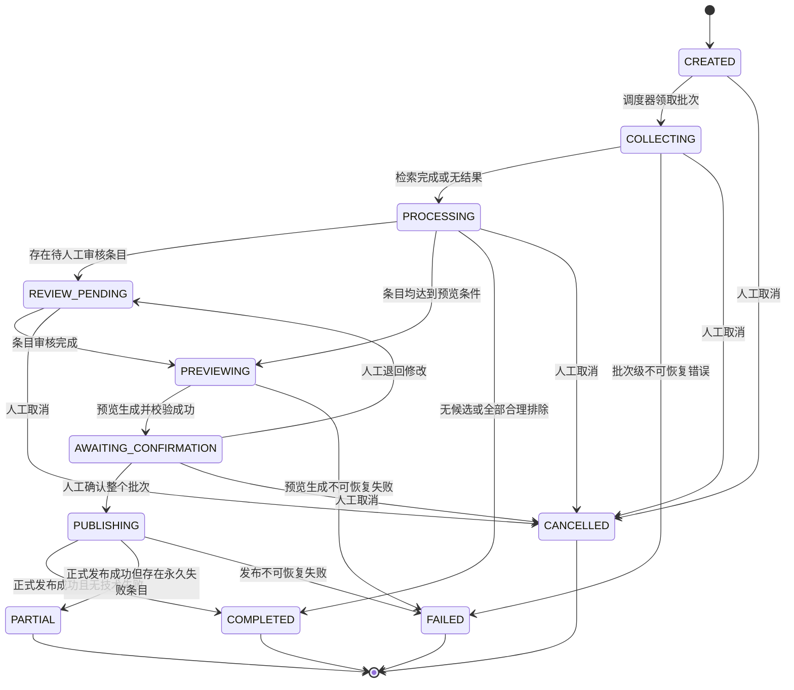
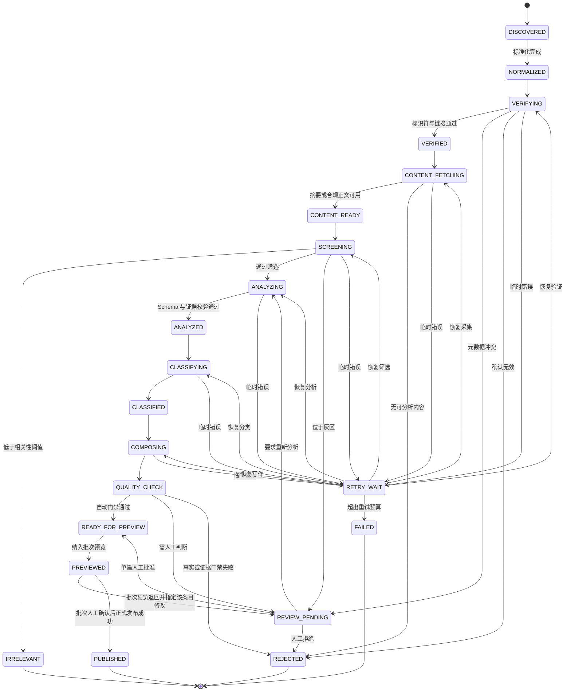

# Agent 状态流转设计

版本：`1.1.0-draft`

## 1. 设计原则

- Workflow Orchestrator 是唯一允许改变流程状态的组件；各 Agent 返回结果或事件，不直接跨状态写库。
- 数据抓取、格式化、去重、链接验证、Schema 校验和网页发布使用确定性代码。
- LLM Agent 只承担相关性筛选、科研分析、语义分类、报告写作和必要的质量复核。
- 批次状态与单篇论文状态分开持久化；单篇失败不应让整个批次回滚。
- 状态转换和产物写入在同一短事务内完成。
- 每个步骤以输入哈希和版本号保证幂等，重试不能产生重复分析或重复报告。
- MVP 的 Quality Gate 只决定条目能否进入预览；正式发布必须经过批次级人工确认。

## 2. 组件职责

| 组件 | 类型 | 输入 | 产物 | 不负责 |
|---|---|---|---|---|
| Scheduler | 确定性 | 调度配置 | `pipeline_run` | 论文分析 |
| Search Collector | 确定性 | 检索式、时间窗 | `source_records` | 语义筛选 |
| Normalizer/Deduplicator | 确定性 | 原始记录 | `papers`、标识符、作者 | 推测缺失元数据 |
| Verification Agent | 确定性 | PMID、DOI、URL、元数据 | `verification_records` | 用 LLM 判断链接有效性 |
| Content Collector | 确定性 | 已验证来源 | 合规摘要/正文片段、哈希 | 绕过付费墙或版权限制 |
| Screening Agent | LLM | 标题、摘要、领域定义 | 相关性分数与理由 | 撰写最终报告 |
| Analysis Agent | LLM | 论文内容快照 | 结构化分析与证据引用 | 补写论文未报告的数据 |
| Classification Agent | 规则 + LLM | 分析结果、领域目录 | 多标签分类与分数 | 创建新领域 |
| Report Agent | LLM | 已验证分析与证据 | 面向研发人员的报告草稿 | 引入输入中不存在的事实 |
| Quality Gate | 确定性 + 可选 LLM | 全部产物 | 质量分、预览资格/单篇审核决策 | 修改科研事实 |
| Preview Builder / Publisher | 确定性 | 已批准条目、批次确认 | 预览网页、正式网页、内容哈希 | 绕过质量门禁或批次确认 |

## 3. 批次级状态机



### 3.1 批次状态定义

| 状态 | 进入条件 | 退出条件 |
|---|---|---|
| `CREATED` | 配置快照和触发信息已持久化 | worker 成功取得租约 |
| `COLLECTING` | 开始执行所有激活检索式 | 每个检索式成功、明确无结果或已记录失败 |
| `PROCESSING` | 候选已标准化并创建论文任务 | 所有论文任务进入终态或待审核 |
| `REVIEW_PENDING` | 至少一个论文条目必须人工判断，或批次预览被退回修改 | 所有待审核条目被批准/拒绝 |
| `PREVIEWING` | 条目已通过 Quality Gate 或逐条审核 | 预览目录、页面、链接和预览哈希生成成功 |
| `AWAITING_CONFIRMATION` | 批次预览可供检查 | 人工确认整个批次，或退回修改/取消 |
| `PUBLISHING` | 已记录批次级确认人、确认时间，且预览哈希未变化 | 相同内容原子写入正式发布目录 |
| `COMPLETED` | 无未处理错误；允许 0 篇日报 | 终态 |
| `PARTIAL` | 有永久失败/未完成审核，但已保留有效成果 | 终态，可通过 `replay` 新建补偿批次 |
| `FAILED` | 批次无法产出或发布，例如配置损坏、数据库不可用 | 终态，可人工重放 |
| `CANCELLED` | 收到人工取消，当前安全步骤结束后停止领取新任务 | 终态 |

`IRRELEVANT`、元数据冲突后人工拒绝、没有摘要且无法合法获取内容等属于可解释业务结果，不计入 `failed_count`。只有技术失败或违反处理契约才计入失败。

## 4. 单篇论文状态机



`RETRY_WAIT` 必须在 `paper_tasks.resume_state` 保存唯一恢复目标；该字段已纳入 ER 设计，并在非 `RETRY_WAIT` 状态置空。

## 5. 单篇状态转换契约

| 当前状态 | 执行方 | 成功后 | 主要守卫条件 |
|---|---|---|---|
| `DISCOVERED` | Normalizer | `NORMALIZED` | 标题存在；标识符已规范化；已解析或创建 `paper` |
| `NORMALIZED` | Orchestrator | `VERIFYING` | `paper_task` 唯一；无未解决的强标识符冲突 |
| `VERIFYING` | Verification Agent | `VERIFIED` / `REVIEW_PENDING` / `REJECTED` | PMID/DOI 至少一个有效，或可信来源元数据一致；URL 结果已记录 |
| `VERIFIED` | Orchestrator | `CONTENT_FETCHING` | 最新验证结果未过期 |
| `CONTENT_FETCHING` | Content Collector | `CONTENT_READY` / `REJECTED` | 至少有标题和可分析摘要；内容来源及哈希已记录 |
| `CONTENT_READY` | Orchestrator | `SCREENING` | 输入快照通过长度、编码和注入隔离检查 |
| `SCREENING` | Screening Agent | `ANALYZING` / `IRRELEVANT` / `REVIEW_PENDING` | JSON Schema 有效；分数和决策匹配 |
| `ANALYZING` | Analysis Agent | `ANALYZED` | 关键发现均有 evidence；未报告项为 null；Schema 有效 |
| `ANALYZED` | Orchestrator | `CLASSIFYING` | 分析版本已写入且 `ai_run=succeeded` |
| `CLASSIFYING` | Classification Agent | `CLASSIFIED` | 只使用当前激活领域 code；至少一个类别达到阈值 |
| `CLASSIFIED` | Orchestrator | `COMPOSING` | 分类记录与分析版本一致 |
| `COMPOSING` | Report Agent | `QUALITY_CHECK` | 报告 JSON 有效；引用只来自已验证链接 |
| `QUALITY_CHECK` | Quality Gate | `READY_FOR_PREVIEW` / `REVIEW_PENDING` / `REJECTED` | 质量规则全部执行并记录原因码；通过不等于已批准正式发布 |
| `REVIEW_PENDING` | 单篇人工审核 | `READY_FOR_PREVIEW` / `ANALYZING` / `REJECTED` | 审核人和操作理由已审计 |
| `READY_FOR_PREVIEW` | Preview Builder | `PREVIEWED` | 报告条目已冻结；预览页面生成与本地链接校验成功 |
| `PREVIEWED` | Batch Publisher | `PUBLISHED` / `REVIEW_PENDING` | 整个批次已人工确认且预览哈希未变化，或被退回修改 |

任何不在转换表中的状态改变必须拒绝，并追加 `rejected_transition` 事件；不得悄悄修正状态。

## 6. Orchestrator 状态载荷

各 Agent 通过统一的最小状态载荷协作。大型论文正文或完整 API 响应不在 Agent 间复制，只传数据库引用和内容哈希。

```python
class WorkflowState:
    pipeline_run_id: str
    paper_task_id: str
    paper_id: int
    state: str
    resume_state: str | None
    content_snapshot_id: str | None
    current_analysis_id: int | None
    prompt_versions: dict[str, str]
    attempt_count: int
    warnings: list[str]
    last_error: dict | None
```

这是接口契约示意，不是要求现在引入特定 Agent 框架。MVP 用普通 Python 服务和显式状态机即可；只有在分支、并行和长时间人工等待显著增加后再考虑 LangGraph。

## 7. 分支判定规则

### 7.1 相关性筛选

默认阈值由配置版本化，不写死在 Prompt：

| 分数 | 决策 |
|---|---|
| `>= 0.75` | `ANALYZING` |
| `< 0.45` | `IRRELEVANT` |
| `0.45–0.7499` | `REVIEW_PENDING` |

如果摘要缺失、目标领域定义不完整或模型明确标记证据不足，即使得分较高也进入人工审核。

### 7.2 自动预览门禁

只有同时满足下列条件才允许 `READY_FOR_PREVIEW`：

- PMID 或 DOI 至少一个通过，并且展示 URL 有效。
- 所有关键发现至少有一条 `direct` evidence。
- `paper_analyses.confidence >= 0.80`。
- 质量总分 `>= 0.85`。
- 没有元数据冲突、医学诊疗建议、确定性因果夸大或输入外数字。
- Prompt、模型、输入哈希和输出 Schema 版本均已记录。

质量分 `0.65–0.8499` 进入单篇人工审核；低于 `0.65` 或出现硬性事实门禁失败时进入 `REJECTED`。阈值应进入批次 `config_snapshot`。即使达到 `READY_FOR_PREVIEW`，MVP 也不能自动正式发布。

### 7.3 批次级正式发布确认

MVP 固定流程为：AI 处理完成 → Quality Gate → 生成预览 → 人工确认 → 正式发布。

- 配置项 `require_batch_publish_confirmation` 默认且强制为 `true`。
- 人工确认对象是完整 `publication_batch`，不是单篇条目。
- 确认时记录 `confirmed_by`、`confirmed_at`、`confirmation_note` 和 `preview_sha256`。
- 正式发布前重新计算预览哈希；与确认时不一致必须退回 `AWAITING_CONFIRMATION`。
- 后续系统稳定后可显式将配置设为 `false`；该能力在 MVP 不启用，且不能由 Quality Gate 分数隐式触发。

## 8. 错误分类与重试

| 错误类别 | 示例 | 是否重试 | 处理 |
|---|---|---|---|
| `TRANSIENT_NETWORK` | 超时、连接重置 | 是 | 指数退避 + 随机抖动 |
| `RATE_LIMITED` | HTTP 429 | 是 | 优先尊重 `Retry-After` |
| `UPSTREAM_5XX` | PubMed/模型服务 5xx | 是 | 有上限重试 |
| `INVALID_LLM_OUTPUT` | JSON 解析或 Schema 失败 | 有限 | 同版本最多 1 次约束性修复，再失败转审核/失败 |
| `CONTENT_UNAVAILABLE` | 无摘要且无法合法获取内容 | 否 | `REJECTED`，业务原因码 |
| `IDENTIFIER_INVALID` | DOI/PMID 明确不存在 | 否 | `REJECTED` |
| `METADATA_CONFLICT` | DOI 标题与 PubMed 标题明显不一致 | 否 | `REVIEW_PENDING` |
| `POLICY_BLOCKED` | 需要绕过付费墙或越权访问 | 否 | `REJECTED` 并记录来源 |
| `CONFIGURATION_ERROR` | Prompt key 或领域 code 不存在 | 否 | 单篇 `FAILED`；广泛发生时批次 `FAILED` |
| `DATABASE_ERROR` | 写入/迁移失败 | 谨慎 | 回滚；批次暂停，避免重复调用外部服务 |

默认重试预算：网络/API 步骤 4 次，LLM 请求 3 次，LLM Schema 修复 1 次。退避建议为 30 秒、2 分钟、10 分钟、30 分钟；实际 `next_retry_at` 必须带 0–20% 抖动。

## 9. 幂等与并发

### 9.1 幂等键

| 步骤 | 幂等键 |
|---|---|
| 检索 | `pipeline_run_id + search_query_id + external_id` |
| 论文去重 | `scheme + normalized_identifier` |
| 单篇任务 | `pipeline_run_id + paper_id` |
| LLM 执行 | `paper_task_id + step + prompt_version_id + input_sha256` |
| 分析版本 | `paper_id + version`，版本只在有效新结果提交时递增 |
| 报告条目 | `publication_batch_id + paper_id` |
| 发布文件 | `publication_batch_id + content_sha256` |

### 9.2 任务领取

worker 领取任务时写入 `locked_by` 和 `locked_until`。只有租约持有者可提交该步骤结果；长任务需续租。租约过期后允许回收，但提交前必须再次校验所有权，防止迟到结果覆盖新结果。

### 9.3 取消

取消只阻止领取新任务。正在执行的外部调用完成后可以保存可复用结果，但不得继续下一状态。已生成的临时发布目录应清理或标记为未提交，不能替换线上目录。

## 10. 人工审核协议

人工审核必须选择明确动作：

- `approve`：确认单篇报告可进入批次预览。
- `reject`：记录原因码，终止该论文任务。
- `reanalyze`：选择新的 Prompt/模型版本或补充合规输入，回到 `ANALYZING`。
- `fix_metadata`：修正元数据后创建验证事件，从 `VERIFYING` 重新进入流程。

单篇审核通过不等于正式发布授权。预览生成后，必须再执行一次批次级 `confirm_batch`，记录确认人、确认时间和预览哈希。禁止人工直接把任务从任意状态改成 `PUBLISHED`；只有 Publisher 在已确认批次正式发布成功后才能转换。所有审核与确认动作必须写入审计事件。

## 11. 可观测性指标

MVP 至少记录：

- 每批次候选数、去重数、验证通过率、相关率、发布率。
- 每状态停留时间和积压数量。
- 各数据源/API 的成功率、429 率、P95 延迟。
- 各 Prompt 版本的 Schema 通过率、人工审核率、拒绝率。
- 单篇平均 token、估算成本和端到端处理时长。
- `claim_without_direct_evidence` 数量，目标必须为 0。

## 12. 状态机验收场景

1. 同一 PMID 在同一批次出现两次，只产生一个 `paper_task`。
2. PubMed 暂时 503，任务进入 `RETRY_WAIT` 并从 `VERIFYING` 恢复。
3. LLM 返回非 JSON，自动修复一次；仍失败则进入人工审核或 `FAILED`。
4. 摘要未报告样本量，分析结果保存 `null`，不得编造数字。
5. 关键发现没有直接证据，质量门禁禁止进入预览。
6. worker 在调用 LLM 后崩溃，重新执行时命中幂等记录，不产生重复分析。
7. 部分论文永久失败，其他论文仍可生成日报，批次最终为 `PARTIAL`。
8. 零检索结果是成功空批次，最终为 `COMPLETED`，不是 `FAILED`。
9. Quality Gate 全部通过后只能生成预览；没有批次确认记录时正式发布调用必须失败。
10. 人工确认后预览文件发生变化，哈希守卫阻止发布并要求重新确认。
